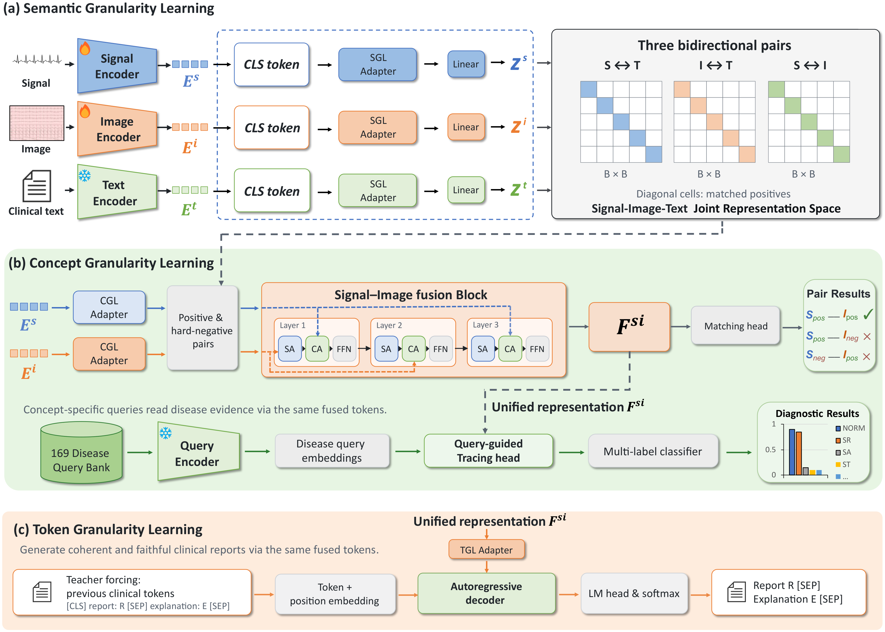

<div align="center">

# LaUER

### One Representation for Detection and Interpretation

**Language-anchored Unified ECG Representation Learning**  
*via Signal, Image, and Clinical Text*

**Semantic anchors → Concept anchors → Token anchors**

[Overview](#overview) · [Installation](#installation) · [Data](#data) · [Training](#training) · [Downstream tasks](#downstream-tasks) · [Code map](#code-map)

</div>

<p align="center">
  
</p>
<p align="center"><em>Progressive language guidance learns one fused ECG representation for disease detection and interpretation.</em><br><a href="docs/assets/overview.pdf">Vector architecture figure (PDF)</a></p>

## Overview

Electrocardiograms are routinely read as **waveforms**, stored as **printed 12-lead images**, and described in **clinical language**. Most ECG models pick one of these views and discard the rest. LaUER asks a different question: can a *single* representation, shaped by language at three levels of granularity, serve both **disease detection** and **interpretation** at once?

LaUER is a language-anchored framework that learns one unified ECG representation from **signal, image, and clinical text**. ECG images complement the signal view — they carry the lead layout, calibration, and presentation conventions that a raw waveform does not — while clinical language *guides* representation learning rather than merely supervising a label. Because the supervision is introduced at three granularities, the representation is progressively refined from coarse semantic agreement down to token-level clinical evidence.

Training is cumulative:

```text
SGL                    SGL + CGL                         SGL + CGL + TGL
Semantic alignment  →  Signal–image fusion and        →  Report and explanation
                       query-guided disease tracing      generation
```

| Stage | Language anchor | Learning objective |
| :--- | :--- | :--- |
| **SGL — Semantic Granularity Learning** | Clinical report and explanation | Align normalized signal, image, and text embeddings through three bidirectional InfoNCE pairs. Signal–text and image–text each receive weight 0.4; signal–image receives 0.2. |
| **CGL — Concept Granularity Learning** | Frozen disease-query embeddings | Fuse signal and image tokens, distinguish matched from hard-negative pairs, and predict disease concepts with the Query-guided tracing head. |
| **TGL — Token Granularity Learning** | Report and explanation tokens | Generate both text regions autoregressively from the same fused ECG memory, with region-balanced token loss. |

Earlier objectives remain active as new ones are introduced. The final stage optimizes all three objectives; it does not train the complete objective from the beginning.

### Architecture at a glance

- **Signal encoder:** ViT-1D over a 12-lead, 5,000-sample waveform.
- **Image encoder:** lead-aware ViT-2D over a 720 × 1,000 RGB ECG image.
- **Semantic anchor:** frozen MedCPT-Article encodes `report [SEP] explanation`. CLS adapters produce normalized 512-dimensional SGL embeddings.
- **Signal–Image fusion Block:** independent CGL adapters project signal and image tokens to width 768. Three fusion blocks begin with image tokens and attend to the original signal, image, and signal memories in sequence.
- **Query-guided tracing head:** 169 disease concepts are encoded by frozen MedCPT-Query. A trainable projection and three tracing blocks read evidence from the fused memory. A shared affine classifier produces independent disease logits, trained with binary cross-entropy.
- **TGL adapter and autoregressive decoder:** a two-layer adapter connects the fused memory to a six-layer decoder. Its token embeddings are initialized from MedCPT-Article and tied to the language-model output head.

The text target is:

```text
[CLS] report: <report> [SEP] explanation: <explanation> [SEP]
```

The first separator ends the report; the second ends generation. Report and explanation losses receive equal regional weights. Query attention and generated explanations are model outputs, not independently validated clinical explanations.

### What you get

| Capability | Entry point | Output |
| :--- | :--- | :--- |
| Three-stage pretraining | `train.py`, `train_ddp.py` | Stage artifacts under `output/stage/lauer/` |
| Linear probing | `linear_probe/` | Multilabel metrics on PTB-XL, CPSC2018, CSN |
| Zero-shot classification | `zeroshot/` | Semantic-alignment and query-guided concept scores |
| Report + explanation generation | `inference.py` | Free-text report and explanation from signal + image |
| Representation inspection | `visualization/` | Attention maps, Grad-CAM overlays, t-SNE views |

## Installation

Run all commands from the repository root. The source was checked locally with **Python 3.9.25**, **PyTorch 2.5.1**, and **Transformers 4.57.6**. A CUDA GPU is needed for practical pretraining; the supplied batches are large and must be adjusted to available memory.

```bash
python -m venv .venv
# Activate the environment using your shell's activation command.
python -m pip install -r requirements.txt
```

Install a PyTorch build compatible with your GPU/runtime when configuring the environment. The pinned package versions describe the local verification environment; they do not establish a tested hardware or distributed-training matrix.

For tests or optional visualization tools:

```bash
python -m pip install -r requirements-dev.txt
python -m pip install -r requirements-optional.txt
```

### External weights

Place locally downloaded Hugging Face model directories here:

```text
weights/
├── MedCPT-Article-Encoder/   # Model, tokenizer, and configuration files
└── MedCPT-Query-Encoder/     # Model, tokenizer, and configuration files
```

Use the [`ncbi/MedCPT-Article-Encoder`](https://huggingface.co/ncbi/MedCPT-Article-Encoder) and [`ncbi/MedCPT-Query-Encoder`](https://huggingface.co/ncbi/MedCPT-Query-Encoder) model assets. Loading uses `local_files_only=True`; the training scripts do not download these models automatically. See [weights/README.md](weights/README.md).

The supplied ViT checkpoint paths are empty, so the signal and image encoders initialize from scratch. Set their `checkpoint_path` values only when intentionally using compatible encoder weights. Trained LaUER weights and external model weights are not bundled.

## Data

### Pretraining

Prepare paired MEETI records and split annotation files:

```text
datasets/MEETI/
└── pXX/<subject>/<study>/
    ├── <study_id>.mat
    └── <study_id>.png

data/annotations/
├── train.csv
├── val.csv
└── test.csv
```

Each MAT record contains `signal` with shape `[12, 5000]`, `report`, and `LLM_Interpretation`. The PNG is the corresponding ECG image with the lead layout expected by the image encoder. Keep one matching MAT/PNG pair per study directory. A compatible optional `file_index/` can accelerate discovery; otherwise the loader scans the directory tree.

Each annotation CSV begins with:

```text
subject_id,study_id,total_report,<169 binary disease-label columns>
```

The canonical concept names are in [data/concepts.json](data/concepts.json). CSV label names must match this vocabulary, and column order must be consistent across splits. That order determines the query bank and output logits. The `study_id` values connect annotations to records and define split membership. The paper uses a 96/2/2 train/validation/test split; provide those splits explicitly when reproducing that protocol.

Update `data.annotation_csv`, `data.val_annotation_csv`, and `data.test_annotation_csv` in the YAML files for your annotation locations. `--data_root` overrides the paired-record root. Patient records, reports, annotations, and generated outputs are not included in this repository.

### Downstream datasets

The default local roots are:

| Dataset | Directory | Linear-probe task keys |
| :--- | :--- | :--- |
| PTB-XL | `datasets/PTB-XL` | `ptbxl_super_class`, `ptbxl_sub_class`, `ptbxl_form`, `ptbxl_rhythm` |
| CPSC2018 | `datasets/CPSC2018` | `icbeb` |
| CSN | `datasets/CSN` | `chapman` |

The legacy CLI keys `icbeb` and `chapman` remain compatibility identifiers. Active split folders and filenames use `CPSC`, `CSN`, and `ptbxl` under `linear_probe/data_split/`. Labels were rebuilt from original annotations; historical MELP targets are not unchanged. Obtain the underlying datasets separately and retain their expected record layout:

- [PTB-XL](https://physionet.org/content/ptb-xl/1.0.3/)
- [CPSC2018](http://2018.icbeb.org/Challenge.html)
- [CSN (Chapman–Shaoxing–Ningbo)](https://physionet.org/content/ecg-arrhythmia/1.0.0/)

For linear probing, external roots can also be configured through `LAUER_PTBXL_ROOT`, `LAUER_ICBEB_ROOT`, and `LAUER_CHAPMAN_ROOT`.

## Training

Stage names in Python and YAML use lowercase: `sgl`, `sgl+cgl`, and `sgl+cgl+tgl`. Each stage initializes from the preceding stage's weights.

**1. Semantic Granularity Learning**

```bash
python train.py --mode sgl --config configs/pretrain_SGL.yaml --data_root datasets/MEETI
```

**2. Add Concept Granularity Learning**

```bash
python train.py --mode sgl+cgl --config configs/pretrain_SGL+CGL.yaml --data_root datasets/MEETI --init-from output/stage/lauer/sgl/best_weights.pt
```

**3. Add Token Granularity Learning**

```bash
python train.py --mode sgl+cgl+tgl --config configs/pretrain_SGL+CGL+TGL.yaml --data_root datasets/MEETI --init-from output/stage/lauer/sgl_cgl/best_weights.pt
```

The default stage directories are `output/stage/lauer/sgl/`, `sgl_cgl/`, and `sgl_cgl_tgl/`. `best_weights.pt` stores stage weights; `checkpoint.pt` is used to resume training.

### Distributed training and resuming

```bash
torchrun --nproc_per_node=2 train_ddp.py --mode sgl --config configs/pretrain_SGL.yaml --data_root datasets/MEETI

python train.py --mode sgl+cgl+tgl --config configs/pretrain_SGL+CGL+TGL.yaml --data_root datasets/MEETI --resume output/stage/lauer/sgl_cgl_tgl/checkpoint.pt
```

`--batch_size` is the physical batch **per GPU**. Optimizer batch size also depends on gradient accumulation and world size. Use `--init-from` for a stage transition and `--resume` for continuation within the same stage; they are mutually exclusive. Use `--no_auto_resume` when intentionally starting a fresh run in an existing output location.

<details>
<summary><strong>Configuration scope and paper schedule</strong></summary>

The active module layouts in the three supplied YAML files implement the paper's SGL/CGL/TGL architecture. Their optimization settings preserve the working configurations supplied with this code and are **not an exact copy of the paper's training schedule**.

| Setting | Supplied YAML: SGL / CGL / TGL | Paper schedule: SGL / CGL / TGL |
| :--- | :--- | :--- |
| Physical batch per GPU | 416 / 108 / 64 | 468 / 108 / 64 |
| Maximum epochs | 50 / 50 / 50 | 50 / 5 / 5 |
| Scheduler | cosine / cosine / cosine | cosine / constant / cosine |
| Early-stop patience | 5 / 5 / 5 | 5 / 3 / 2 |
| Weight decay | 0.10 / 0.05 / 0.05 | 0.10 / 0.05 / 0.01 |
| Warmup | 2,000 steps / 0.03 ratio / 0.02 ratio | 2,000 / 436 / 294 steps |

Gradient accumulation is 2 in the supplied files. Data augmentation is disabled. Review the full training protocol and YAML settings before claiming exact paper reproduction. Optional hybrid masking and other configurable alternatives remain in the source; the supplied TGL configuration selects autoregressive generation.

</details>

## Downstream tasks

### Linear probing

Freeze a trained encoder and fit a linear multilabel classifier. The paper setting uses the raw signal/image CLS feature or the fused signal–image CLS feature. It does not use the normalized SGL projection as the default probe input.

```bash
python -m linear_probe.run --task ptbxl_super_class --mode fusion --ratio 1.0 --budget melp --encoder-checkpoint output/stage/lauer/sgl_cgl_tgl/best_weights.pt --config configs/pretrain_SGL+CGL+TGL.yaml
```

Modes are `signal_only`, `image_only`, and `fusion`. Label fractions are `0.01`, `0.1`, and `1.0`. Fusion requires a checkpoint trained with CGL. See [linear_probe/README.md](linear_probe/README.md) for task matrices, caching, and path configuration.

### Zero-shot classification

Prepare benchmark manifests before running inference:

```bash
python -m zeroshot.data.prepare_benchmarks --ptbxl-root datasets/PTB-XL --cpsc-root datasets/CPSC2018 --melp-split-root linear_probe/data_split
python -m zeroshot.data.prepare_csn --csn-root datasets/CSN --melp-split-root linear_probe/data_split/CSN --output-root zeroshot/splits/csn

python -m zeroshot.run_experiments --checkpoint output/stage/lauer/sgl_cgl_tgl/best_weights.pt --config configs/pretrain_SGL+CGL+TGL.yaml --targets ptbxl,cpsc2018,csn --evaluation-split test --run-name lauer_test
```

This entry point computes semantic-alignment and query-guided concept scores without fitting a target-domain classifier. Its record roots are the default `datasets/` directories shown above. The Table 17 cross-domain mapping is in `zeroshot/presets/`. Dataset label definitions and query text are in `zeroshot/mappings/` and `zeroshot/prompts/`. Use a separate run name for validation, test, and smoke runs. `--max-samples` is for smoke checks and does not implement the full benchmark protocol.

The [Table 17 mapping](zeroshot/presets/melp_table17.json) is selected by default. The command below selects it explicitly.

```bash
python -m zeroshot.run_experiments --mapping-preset melp-table17 --checkpoint output/stage/lauer/sgl_cgl_tgl/best_weights.pt --evaluation-split test --run-name melp_table17_test
```

Table 17 jobs keep target records with at least one positive label covered by the mapping. Each target group uses the logical OR of its labels. Each source group averages its raw scores. Groups may overlap, so the same CSN `STE` query can contribute to both CPSC2018 `STE` and `STD`. Each transfer uses the source dataset's query registry and only the distinct source labels in its groups. Generate the manifests from the split CSVs bundled with this repository.

Use `--mapping-path` in place of `--mapping-preset` to select a custom JSON file. Use a separate run name for each mapping.

### Report and explanation generation

```bash
python inference.py --config configs/pretrain_SGL+CGL+TGL.yaml --checkpoint output/stage/lauer/sgl_cgl_tgl/best_weights.pt --signal /path/to/record.mat --image /path/to/record.png --max_len 512 --device cuda
```

Generation uses the same fused signal–image representation used by CGL. No reference report is needed at inference. This is a command-line research workflow.

### Optional representation inspection

The retained [attention/Grad-CAM tools](visualization/attention_grad_cam/README.md) inspect model attention and gradient-based attribution. The [t-SNE tools](visualization/t_sne/README.md) visualize cached representations. These utilities generate new local artifacts; no previously obtained plots or benchmark scores are bundled.

## Code map

| Paper component | Implementation |
| :--- | :--- |
| LaUER and cumulative objectives | `models/lauer.py` → `LaUER` |
| Typed configuration | `configs/config.py` → `LaUERConfig` |
| Signal / image / clinical text encoders | `models/encoders/` |
| SGL and CGL modality adapters | `models/heads/modality_adapter.py` |
| SGL objective | `models/losses/sgl_loss.py` → `SGLLoss` |
| Signal–Image fusion Block | `models/fusion_encoder.py` → `FusionLayer` |
| Matching head and matching objective | `models/losses/cgl_loss.py` |
| Query-guided tracing head | `models/query_guided_tracing_head.py` → `QueryGuidedTracingHead` |
| Autoregressive decoder | `models/tgl.py` → `AutoregressiveDecoder` |
| Region-balanced TGL loss | `models/losses/tgl_loss.py` → `TGLLoss` |
| Checked stage transitions and checkpoint metadata | `training/stage_io.py` |
| Paired pretraining data | `data/meeti_dataset.py` |
| Linear probing / zero-shot classification | `linear_probe/` / `zeroshot/` |

```text
LaUER_main/
├── models/            # LaUER, encoders, fusion, heads, TGL decoder, losses
├── configs/           # Typed config + one YAML per training stage
├── data/              # MEETI paired dataset, concept vocabulary, lead order
├── training/          # Stage I/O, logging, reproducibility, NaN resilience
├── linear_probe/      # Frozen-feature probing + MELP split manifests
├── zeroshot/          # Zero-shot benchmarks, mappings, prompts, scoring
├── visualization/     # Attention / Grad-CAM / t-SNE inspection tools
├── evaluation/        # CGL and zero-shot evaluation helpers
├── docs/assets/       # Architecture figure
└── weights/           # External MedCPT directories (not distributed)
```

`lauer` is the project identifier; `LaUER` is the paper acronym and Python class spelling. SGL/CGL/TGL identify the training stages. The architectural term *autoregressive decoder* remains appropriate for the module used by TGL.

### Checkpoint compatibility

This release uses LaUER module paths and SGL/CGL/TGL configuration and state-dictionary keys. Checkpoints from earlier private naming schemes require explicit key/configuration migration; renaming the checkpoint file is insufficient. No legacy migration tool is included. Load checkpoints produced by this code with their matching YAML configuration. Stage artifacts omit frozen MedCPT parameters, so both external encoder directories must remain available.

## Verification

```bash
python -m pytest tests linear_probe/tests -q -p no:cacheprovider
python train.py --help
python -m linear_probe.run --help
python -m zeroshot.run_experiments --help
```

Synthetic tests cover cumulative forward/backward execution, alignment loss, fusion/query gradients, causal TGL generation logits, and checkpoint metadata. Tests requiring external datasets may skip when those datasets are unavailable. Passing these checks is not evidence of a complete pretraining or benchmark reproduction run.

## Acknowledgments

The implementation uses [MedCPT](https://github.com/ncbi/MedCPT) for clinical language anchors and retains downstream split and prompt conventions associated with [MELP](https://github.com/HKU-MedAI/MELP). The disease-query learning design builds on the supervision approach explored by [MERL](https://github.com/cheliu-computation/MERL-ICML2024) and [SuPreME](https://github.com/mingscai/SuPreME). Consult the original projects and dataset/model providers for attribution and the terms governing their assets.

## Citation

The accompanying manuscript is titled **“One Representation for Detection and Interpretation: Language-anchored Unified ECG Representation Learning via Signal, Image, and Clinical Text.”** Publication metadata and a formal citation should be added when finalized.

```bibtex
@article{lauer2026one,
  title   = {One Representation for Detection and Interpretation:
             Language-anchored Unified ECG Representation Learning
             via Signal, Image, and Clinical Text},
  author  = {LaUER Authors},
  journal = {arXiv preprint},
  year    = {2026}
}
```

> The BibTeX entry above is a placeholder. Replace the author list, venue, and year once the manuscript is finalized.
